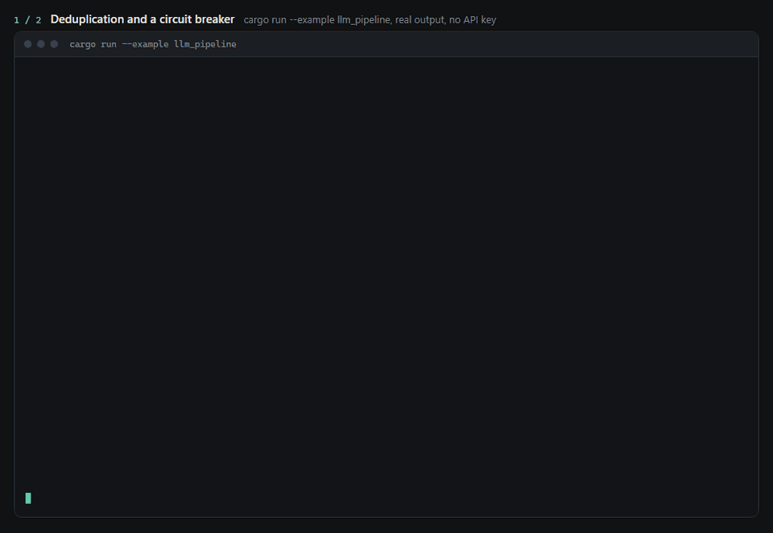
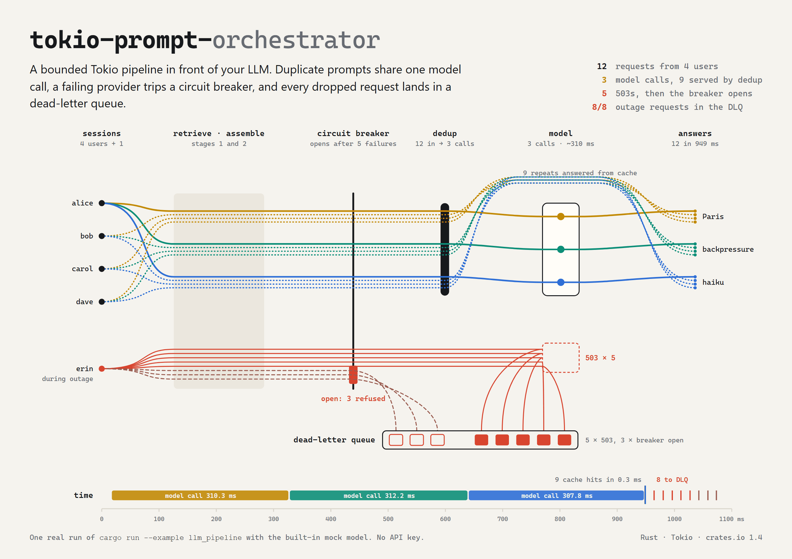

# tokio-prompt-orchestrator

<!-- outcome-block -->
**Ran 24 Claude Code agents on one RTX 4070. Cut API use to 26% of expected.**

A plain queue sends every duplicate to the API. This sends it once.

If it doesn't do what this README says, [open an issue](https://github.com/Mattbusel/tokio-prompt-orchestrator/issues) and I'll fix it.
<!-- outcome-block -->

English | [简体中文](README.zh-CN.md) | [日本語](README.ja.md) | [한국어](README.ko.md)

**Sits between your app and the model (Anthropic, OpenAI, llama.cpp, vLLM). The same prompt twice costs one call. When the provider goes down, requests fail fast with a reason.**

Run it as a server (`orchestrator`) or use it as a Rust library.

<p>
  <a href="https://crates.io/crates/tokio-prompt-orchestrator"></a>
  <a href="https://docs.rs/tokio-prompt-orchestrator"></a>
  <a href="https://gitlab.com/mattbusel/tokio-prompt-orchestrator/-/releases"></a>
  <a href="LICENSE"></a>
  <a href="https://github.com/Mattbusel/tokio-prompt-orchestrator/actions/workflows/ci.yml"></a>
  
</p>



<sub>Real recording, sped up only while waiting. <a href="https://tokio-prompt-orchestrator.vercel.app/">The site</a> replays it step by step.</sub>

## Numbers

- [LLM proxy benchmark: 200 duplicate calls became 1](https://tensorust.com/articles/llm-proxy-benchmark/?utm_source=github&utm_medium=readme&utm_campaign=tokio-prompt-orchestrator) measures dedup on real traffic, and the one bug it found.
- [LLM semantic cache: stop paying twice for the same answer](https://tensorust.com/articles/llm-semantic-cache-duplicate-prompts/?utm_source=github&utm_medium=readme&utm_campaign=tokio-prompt-orchestrator) covers when a cache pays off.
- [Exponential backoff with jitter: 64 of 100 LLM calls failed](https://tensorust.com/articles/exponential-backoff-jitter/?utm_source=github&utm_medium=readme&utm_campaign=tokio-prompt-orchestrator) explains the retry stage.
- Price your workload with the free [LLM API cost calculator](https://tensorust.com/tools/llm-api-cost/?utm_source=github&utm_medium=readme&utm_campaign=tokio-prompt-orchestrator) and [token counter](https://tensorust.com/tools/token-counter/?utm_source=github&utm_medium=readme&utm_campaign=tokio-prompt-orchestrator).

## Install

**Linux** (x86_64, Ubuntu 20.04+ / Debian 11+). One line. Installs to `~/.local/bin`:

```sh
mkdir -p ~/.local/bin && curl -fsSL https://gitlab.com/mattbusel/tokio-prompt-orchestrator/-/releases/permalink/latest/downloads/orchestrator-linux-x86_64.tar.gz | tar xz --strip-components=1 -C ~/.local/bin --wildcards '*/orchestrator'
```

| Other systems | |
|---|---|
| **Windows** | [Download orchestrator-windows-x86_64.exe](https://gitlab.com/mattbusel/tokio-prompt-orchestrator/-/releases/permalink/latest/downloads/orchestrator-windows-x86_64.exe) and run it. (Unsigned, so SmartScreen may ask: *More info*, then *Run anyway*.) |
| **macOS, or from source** | `cargo install --locked tokio-prompt-orchestrator --features web-api,tantivy` (add `fastembed` for `--semantic-dedup`) |

Each one installs the same `orchestrator` command. Releases with SHA-256 checksums: [Releases](https://gitlab.com/mattbusel/tokio-prompt-orchestrator/-/releases).

## Drop-in OpenAI proxy

Start `orchestrator` and point your OpenAI client at it. You get dedup, the circuit breaker, timeouts, a spend cap and the dead-letter queue. No code change.

```sh
export OPENAI_BASE_URL=http://127.0.0.1:8080/v1
```

With `orchestrator --provider echo` running (echo replies with your prompt, no key needed), the official Python client (`pip install openai`), unchanged:

```python
from openai import OpenAI

client = OpenAI()  # reads OPENAI_BASE_URL and OPENAI_API_KEY

reply = client.chat.completions.create(
    model="gpt-4o-mini",
    messages=[{"role": "user", "content": "Summarize this ticket"}],
)
print(reply.choices[0].message.content, reply.usage.total_tokens)

for chunk in client.chat.completions.create(
    model="gpt-4o-mini",
    messages=[{"role": "user", "content": "Now stream it"}],
    stream=True,
):
    if chunk.choices:
        print(chunk.choices[0].delta.content or "", end="")
print()
```
```text
Summarize this ticket 10
Now stream it
```

Ask again from `curl`. No model call:

```bash
curl -s -i localhost:8080/v1/chat/completions -H 'Content-Type: application/json' \
  -d '{"model": "gpt-4o-mini", "messages": [{"role": "user", "content": "Summarize this ticket"}]}'
```
```text
x-orchestrator-dedup: cached
{"choices":[{"finish_reason":"stop","index":0,"logprobs":null,"message":{"content":"Summarize this ticket","refusal":null,"role":"assistant"}}],"created":1790804186,"id":"chatcmpl-4d5284a811bd4c0f90bee01018103e1a","model":"echo","object":"chat.completion","system_fingerprint":null,"usage":{"completion_tokens":5,"prompt_tokens":5,"total_tokens":10}}
```

It uses the provider and model it was started with (say `--provider openai --model gpt-4o-mini`), whatever the request names. Errors use OpenAI's format: 503 while the breaker is open (with `x-should-retry: false`, so the SDK won't retry), 429 at the spend cap. Details: [docs/REFERENCE.md](docs/REFERENCE.md#openai-compatible-api).

OpenAI token counts come from the real tokenizer, so they match your bill. Other models are estimated at about 4 characters per token.

## Drop-in Anthropic proxy

Same for Anthropic. Point the base URL at it and `POST /v1/messages` gets dedup, the breaker and the spend cap. The official Python SDK, unchanged, against `orchestrator --provider echo`:

```python
import anthropic

client = anthropic.Anthropic(base_url="http://127.0.0.1:8080", api_key="local")
msg = client.messages.create(
    model="claude-sonnet-4-6",
    max_tokens=200,
    messages=[{"role": "user", "content": "Summarize this ticket"}],
)
print(msg.content[0].text, msg.stop_reason)

with client.messages.stream(model="claude-sonnet-4-6", max_tokens=200,
                            messages=[{"role": "user", "content": "Now stream it"}]) as s:
    print("".join(s.text_stream))
```
```text
Summarize this ticket end_turn
Now stream it
```

Supports text, system prompts and streaming. Image and tool blocks get an `invalid_request_error`. The key goes in `x-api-key` or `Authorization: Bearer`.

## Server flags

The main flags (`orchestrator --help` lists all):

| Flag | Default | What it does |
|---|---|---|
| `--concurrency <N>` | 16 | Model calls at once. 20 prompts on a 1.5 s provider take about 1.5 s at the default, about 30 s at `--concurrency 1`. Identical prompts always share one call. |
| `--timeout <seconds>` | 30 (60 for `anthropic`) | Max time for one call. Past it you get `504 upstream_timeout` and it counts as a failure, so a provider that hangs opens the breaker. |
| `--retries <N>` | 0 | Retries 429s, 5xx and network errors, with backoff. |
| `--max-spend <dollars>` | none | Spend cap. Returns 429 once hit. |
| `--semantic-dedup [0.5-1.0]` | off | Reuses answers to reworded questions (needs `fastembed`). |
| `--docs <folder>` | off | Answers from your own Markdown and text files (needs `tantivy`). |

While the breaker is open you get `503 circuit_open`, `x-should-retry: false`, and a `Retry-After` for when it tries again. The OpenAI and Anthropic SDKs read `x-should-retry`, so they fail at once.

## Answer from your own documents

`orchestrator --docs ./my-docs` indexes a folder of Markdown and text files ([tantivy](https://crates.io/crates/tantivy) BM25, in memory). It puts the best passages and their file names in front of each question. Real run with `--provider echo`, showing what the model gets:

```text
  Answering from 2 passages in ./demo-docs
> How long do refunds take?
Use the following excerpts to answer. If they do not contain the answer, say so. [1] (policies/refunds.md) # Refunds Refunds are issued to the original card within 14 days of us receiving the return. Gift cards cannot be refunded. Question: How long do refunds take?
```

If search fails or takes over 2 seconds, the prompt goes without context. A request is never dropped for it. In Rust: `spawn_pipeline_with(worker, PipelineOptions::with_retriever(Arc::new(TantivyRetriever::index_dir("./docs")?)))`, or implement `Retriever` over your own search (vector DB, Elasticsearch, Postgres).

## Semantic dedup: same question, different words

Exact dedup only catches identical prompts. With an embedder, reworded questions also hit the cache (`x-orchestrator-dedup: semantic`, score in `x-orchestrator-similarity`). `orchestrator --semantic-dedup` uses a local model ([fastembed](https://crates.io/crates/fastembed), BGE-small, no key, 128 MB downloaded once). In Rust, `Deduplicator::with_embedder` takes it or an OpenAI/genai embedder.

Embeddings alone aren't safe. "Convert 10 miles to kilometers" and "Convert 10 kilometers to miles" score 0.99 with BGE-small. So a match also needs the same numbers and shared words in the same order. Test pairs (`tests/semantic_dedup_tests.rs`), default threshold 0.93:

| Pair | Similarity | Answer reused |
|---|---|---|
| "What is the capital of France?" / "Which city is the capital of France?" | 0.959 | yes |
| "How many ounces are in a pound?" / "How many oz in one lb?" | 0.931 | yes |
| "How do I reverse a list in Python?" / "What's the way to reverse a Python list?" | 0.985 | no (word order; costs one call) |
| "Convert 10 miles to kilometers" / "Convert 10 kilometers to miles" | 0.992 | no |
| "Is 17 a prime number?" / "Is 21 a prime number?" | 0.845 | no |

When unsure, it makes a second call instead of reusing the wrong answer. Check your own traffic before lowering the threshold.

## How it works


Each stage is its own Tokio task. A full channel never grows memory. The request goes to the dead-letter queue with a reason, and HTTP returns `429` with `Retry-After`. The drawing comes from [`src/stages.rs`](src/stages.rs). More in [docs/ARCHITECTURE.md](docs/ARCHITECTURE.md).

**Retries.** `orchestrator --retries 2` (or `retry_attempts` in config) retries a 429, 503 or dropped connection after a random wait that doubles each time. It respects `Retry-After`, never retries a bad key, and counts all tries of one request once for the breaker. Off by default.

**Built on known crates.** [backon](https://crates.io/crates/backon) for retry timing, [moka](https://crates.io/crates/moka) for the dedup cache (size-capped, so memory stays bounded), [tiktoken-rs](https://crates.io/crates/tiktoken-rs) for OpenAI token counts, [prometheus](https://crates.io/crates/prometheus) for `/metrics`.

## Examples

**1. Twelve requests, three model calls, then an outage.** `cargo run --example llm_pipeline` (no key needed), real output, trimmed:

```text
1) 12 requests: 4 users x 3 questions
   req-01 alice  The capital of France is Paris.
   req-02 alice  Backpressure means a slow consumer makes fast producers wait instead of letting queues grow without bound.
   ...
   req-12 dave   Bounded channels fill / the sender waits its turn now / memory stays calm
   -> 12 answers in 0.9s, 3 model calls (9 saved by dedup)

2) Provider outage: 8 new requests while every call fails
   DLQ req-13  inference_failure:inference failed: 503 Service Unavailable (simulated outage)
   ...
   DLQ req-17  inference_failure:inference failed: 503 Service Unavailable (simulated outage)
   DLQ req-18  circuit open, failed fast (provider not called)
   DLQ req-19  circuit open, failed fast (provider not called)
   DLQ req-20  circuit open, failed fast (provider not called)
   -> breaker is Open; it lets one probe through after 60s to test recovery
```

<picture>
  <source media="(prefers-color-scheme: dark)" srcset="assets/banner-dark.png">
  
</picture>

Set `PROVIDER=anthropic ANTHROPIC_API_KEY=...` or `PROVIDER=openai OPENAI_API_KEY=...` to make the same 3 calls against a real model. [`examples/llm_pipeline.rs`](examples/llm_pipeline.rs) is a good template.

**2. Over HTTP.** With `orchestrator --provider echo` running:

```bash
curl -s -X POST localhost:8080/api/v1/infer -H 'Content-Type: application/json' -d '{"prompt": "Summarize this ticket"}'
```
```json
{"request_id":"d6a70800-99ef-4f2b-9b27-63b02af7d972","status":"processing"}
```
```bash
curl -s localhost:8080/api/v1/result/d6a70800-99ef-4f2b-9b27-63b02af7d972
```
```json
{"request_id":"d6a70800-99ef-4f2b-9b27-63b02af7d972","status":"completed","result":"Summarize this ticket"}
```
```bash
curl -s localhost:8080/health
```
```json
{"memory":{"rss_bytes":0,"rss_mb":0.0},"pipeline":{"circuit_breaker":{"is_open":false,"state":"closed"},"dead_letter_queue_depth":0,"inbound_queue":{"capacity":512,"depth_pct":0.0,"used":0}},"shutting_down":false,"status":"healthy","uptime_secs":2,"version":"2.0.0","worker_pool":{"pending_requests":0,"tracker_capacity":100000,"tracker_depth_pct":0.0,"tracker_used":1}}
```

**3. In your own Rust code.** [`examples/quickstart.rs`](examples/quickstart.rs), `cargo run --example quickstart`:

```rust,no_run
use std::{collections::HashMap, sync::Arc};
use tokio_prompt_orchestrator::{spawn_pipeline, EchoWorker, ModelWorker, PromptRequest, SessionId};

#[tokio::main]
async fn main() -> Result<(), Box<dyn std::error::Error>> {
    // Swap EchoWorker for AnthropicWorker, OpenAiWorker, LlamaCppWorker, VllmWorker,
    // or a worker over the client you already use (next section).
    let worker: Arc<dyn ModelWorker> = Arc::new(EchoWorker::new());
    let handles = spawn_pipeline(worker);
    let mut output = handles.take_output_rx().await.ok_or("output already taken")?;

    handles.input_tx.send(PromptRequest {
        session: SessionId::new("demo"),
        request_id: "req-1".into(),
        input: "Hello, pipeline!".into(),
        meta: HashMap::new(),
        deadline: None,
    }).await?;

    let answer = output.recv().await.ok_or("pipeline closed")?;
    println!("{}", answer.text);
    for dropped in handles.dlq.drain() { println!("dropped {}: {}", dropped.request_id, dropped.reason); }
    Ok(())
}
```

```text
Hello, pipeline!
```

Needs `tokio-prompt-orchestrator = "2"` and `tokio = { version = "1", features = ["rt-multi-thread", "macros"] }` in `Cargo.toml`.

## Already using async-openai, genai, rig or tower?

Keep your client. Each is a cargo feature that wraps it as a worker, so dedup, the breaker, retries, timeouts and the dead-letter queue sit in front of it.

| You use | Add | Then |
|---|---|---|
| [async-openai](https://crates.io/crates/async-openai) | `features = ["async-openai"]` | `AsyncOpenAiWorker::new(client, "gpt-4o-mini")`: OpenAI, Azure, or any OpenAI-compatible server (Ollama, vLLM, llama.cpp, LM Studio) |
| [genai](https://crates.io/crates/genai) | `features = ["genai"]` | `GenaiWorker::new(genai::Client::default(), "claude-sonnet-4-6")`: OpenAI, Anthropic, Gemini, Ollama, Groq, DeepSeek, xAI and more, picked by model name |
| [rig](https://crates.io/crates/rig-core) | `features = ["rig"]` | `RigWorker::new(OpenAI::from_env()?.completion("gpt-5.2"))`: any rig completion model; rig-core 0.43 or 0.44 (needs Rust 1.95+) |
| [tower](https://crates.io/crates/tower) | `features = ["tower"]` | `ServiceWorker::new(svc)` runs any `Service<String>` (with your tower layers) as a worker; `WorkerService::new(worker)` goes the other way |

```rust,ignore
use std::sync::Arc;
use async_openai::{config::OpenAIConfig, Client};
use tokio_prompt_orchestrator::{integrations::AsyncOpenAiWorker, spawn_pipeline};

// The client you already have, here pointed at a local Ollama.
let client = Client::with_config(
    OpenAIConfig::new().with_api_base("http://localhost:11434/v1").with_api_key("ollama"),
);
let handles = spawn_pipeline(Arc::new(AsyncOpenAiWorker::new(client, "llama3.2")));
```

All four are tested end to end against a mock OpenAI server ([`tests/integrations_tests.rs`](tests/integrations_tests.rs)): replies, streaming, no retry on a bad key, backoff on a 429.

### Feature flags

No features: the pipeline, workers and resilience parts. 167 crates in the tree. The rest is opt-in.

| Feature | Adds |
|---|---|
| `web-api` | HTTP server: REST, SSE, WebSocket and the OpenAI-compatible `/v1/chat/completions` |
| `otel` | OpenTelemetry span export over OTLP/HTTP when `OTEL_EXPORTER_OTLP_ENDPOINT` is set |
| `tiktoken` | Exact OpenAI token counts (on with `web-api`) |
| `metrics-server`, `caching`, `rate-limiting` | `/metrics` endpoint, Redis result cache, token-bucket limiter |
| `full` | All of the above plus `cli` and `hot-reload` |
| `async-openai`, `genai`, `rig`, `tower` | The integrations above |
| `tantivy` | `TantivyRetriever` and `--docs`: answers grounded in a folder of documents (Rust 1.90+) |
| `fastembed` | `FastEmbedder` and `--semantic-dedup`: local embeddings for semantic dedup (Rust 1.88+; on Windows it needs the dynamic C runtime, so not with `+crt-static`) |
| `tui`, `mcp`, `dashboard` | Terminal dashboard, MCP server for Claude Desktop and Claude Code, web dashboard |
| `distributed` | Cross-node dedup over Redis, NATS work queues, leader election |
| `hot-reload`, `cli`, `schema`, `core-pinning` | Config file watcher, the `replay` binary, JSON Schema export, CPU pinning |
| `self-tune`, `self-modify`, `intelligence`, `evolution`, `self-improving` | Experimental self-tuning tiers |

## Use it in 3 steps

1. **Start it.** `orchestrator --provider echo` needs no key. You get a `>` prompt and `http://127.0.0.1:8080`.
2. **Send prompts** from the terminal, or any app with `POST /api/v1/infer` and `GET /api/v1/result/<id>` (example 2 above).
3. **Use a real model.** `orchestrator --reset` asks for a provider and key once and saves them. Or pass them: `ANTHROPIC_API_KEY=sk-ant-... orchestrator --provider anthropic --model claude-sonnet-4-6`.

`orchestrator --help` lists every flag. Problems: see [Troubleshooting](docs/GUIDE.md#troubleshooting).

## Documentation

| Read this | For |
|---|---|
| [docs/GUIDE.md](docs/GUIDE.md) | Running the server, the HTTP API, the terminal dashboard, Claude Desktop and Claude Code (MCP), deployment, tuning, troubleshooting, all examples |
| [docs/REFERENCE.md](docs/REFERENCE.md) | Architecture, resilience building blocks, benchmarks, configuration file, environment variables, feature flags, API table, known issues |
| [docs/MODULES.md](docs/MODULES.md) | Every optional module: plugins, sessions, templates, A/B tests, semantic dedup, cache, rate limiter, cron, DLQ replay and more |
| [docs/ARCHITECTURE.md](docs/ARCHITECTURE.md), [docs/configuration.md](docs/configuration.md) | Pipeline design, every config field with its default |
| [WEB_API.md](WEB_API.md), [BENCHMARKS.md](BENCHMARKS.md), [CHANGELOG.md](CHANGELOG.md) | HTTP endpoints, benchmark runs, release notes |
| [docs.rs](https://docs.rs/tokio-prompt-orchestrator) | Full Rust API |

Contributions welcome: [CONTRIBUTING.md](CONTRIBUTING.md). MIT licensed, see [LICENSE](LICENSE).

Source, issues and stars: [GitHub](https://github.com/Mattbusel/tokio-prompt-orchestrator). Mirror and release downloads: [GitLab](https://gitlab.com/mattbusel/tokio-prompt-orchestrator). More of my Rust: [tensorust.com/open-source](https://tensorust.com/open-source/).

## Hire the author

I build LLM features, iOS apps and performance fixes for clients. Fixed price. [Services and pricing](https://tensorust.com/) · [Email](mailto:mattbusel@gmail.com) · [LinkedIn](https://www.linkedin.com/in/matthewbusel/)
